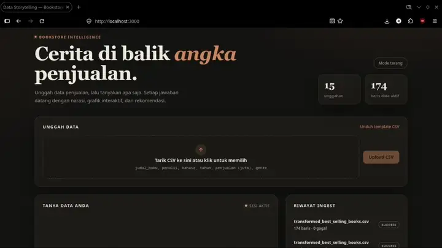

# RAG Data Storytelling

Ubah data penjualan buku menjadi cerita yang mudah dipahami: unggah CSV, tanyakan apa saja, lalu dapatkan narasi, grafik interaktif, dan rekomendasi berbasis data.

Aplikasi ini menggabungkan **retrieval hybrid** (pencarian kata kunci di SQLite + pencarian semantik di ChromaDB) dengan **DeepSeek** sebagai LLM untuk menyusun narasi dan grafik.

## Demo

[](ragbaru.mp4)

Video lengkap (78 detik): [`ragbaru.mp4`](./ragbaru.mp4)

## Fitur

- **Upload CSV fleksibel** lewat drag & drop, dengan validasi baris dan laporan hasil ingest.
- **Tanya jawab data** dalam bahasa natural, lengkap dengan konteks buku, genre, dan penulis.
- **Grafik interaktif** yang bisa diganti tipe tampilannya (batang, garis, lingkar).
- **Narasi + rekomendasi** dari LLM, dengan fallback analisis lokal bila API key belum diisi.
- **Hybrid retrieval**: SQL keyword search dan vector search (sentence-transformers + ChromaDB).
- **Riwayat ingest** yang bisa dibuka untuk melihat detail unggahan.
- **Mode terang/gelap** dengan palet warna hangat dan layout responsif.
- **Salin jawaban** ke clipboard sekali klik.

## Arsitektur

```
┌──────────────┐      /api       ┌──────────────┐
│   Frontend   │ ──────────────▶ │   Backend    │
│ React + Vite │                 │   FastAPI    │
└──────────────┘                 └──────┬───────┘
                                        │
                       ┌────────────────┼────────────────┐
                       ▼                ▼                ▼
                 ┌──────────┐    ┌───────────┐    ┌───────────┐
                 │  SQLite  │    │ ChromaDB  │    │ DeepSeek  │
                 │  sales   │    │  vektor   │    │    API    │
                 └──────────┘    └───────────┘    └───────────┘
```

Alur singkat:

1. CSV diunggah dan divalidasi, lalu disimpan ke SQLite (`sales_transactions` dan `books`).
2. Setiap baris di-embed dengan `sentence-transformers` dan disimpan ke ChromaDB.
3. Pertanyaan pengguna dicari lewat keyword SQL dan vector search, lalu hasilnya dikirim ke DeepSeek.
4. LLM mengembalikan narasi, spesifikasi grafik, dan rekomendasi yang dirender di frontend.

## Tech Stack

| Lapisan | Teknologi |
| --- | --- |
| Frontend | React 18, Vite, Chart.js, react-markdown, Axios |
| Backend | FastAPI, Uvicorn, Pydantic Settings |
| Basis data | SQLite |
| Vector store | ChromaDB, sentence-transformers (`all-MiniLM-L6-v2`) |
| LLM | DeepSeek (`openai` SDK, base URL `api.deepseek.com`) |
| Deployment | Docker Compose, Nginx |

## Struktur Proyek

```
.
├── backend/
│   ├── app/
│   │   ├── api.py         # Endpoint upload, chat, ingest, template
│   │   ├── config.py      # Konfigurasi via environment
│   │   ├── db.py          # Skema dan koneksi SQLite
│   │   ├── prompts.py     # Prompt untuk LLM
│   │   ├── schemas.py     # Model request/response
│   │   └── vector.py      # Indexing dan pencarian Chroma
│   ├── tests/
│   └── Dockerfile
├── frontend/
│   ├── src/
│   │   ├── App.jsx        # UI utama
│   │   ├── chartMapper.js # Konversi spesifikasi chart ke Chart.js
│   │   └── styles.css
│   └── Dockerfile
├── data/
│   ├── sales.db           # Database contoh
│   └── chroma/            # Penyimpanan Chroma (lokal)
├── docker-compose.yml
└── ragbaru.mp4
```

## Menjalankan

### Prasyarat

- Docker dan Docker Compose
- (Opsional) DeepSeek API key untuk narasi berbasis LLM

### Langkah

```bash
git clone https://github.com/ramadhanchan/RAG_DataStorytelling.git
cd RAG_DataStorytelling
cp .env.example .env   # isi DEEPSEEK_API_KEY bila punya
docker compose up -d --build
```

Akses aplikasi:

- Frontend: http://localhost:3000
- Backend: http://localhost:8000 (health check: `/health`)

Tanpa `DEEPSEEK_API_KEY`, aplikasi tetap berjalan memakai analisis lokal sebagai fallback.

### Mode pengembangan

```bash
# Backend
cd backend
python -m venv .venv && source .venv/bin/activate
pip install -r requirements.txt
uvicorn app.main:app --reload

# Frontend
cd frontend
npm install
npm run dev
```

Vite meneruskan request `/api` ke `http://localhost:8000`.

## Format CSV

Kolom wajib (sesuai template):

```csv
judul_buku,penulis,bahasa,tahun,penjualan (juta),genre
Laskar Pelangi,Andrea Hirata,Indonesia,2005,8.5,Sastra
```

Template bisa diunduh langsung dari aplikasi atau endpoint `GET /api/template/csv`.

## Endpoint API

| Method | Endpoint | Keterangan |
| --- | --- | --- |
| GET | `/health` | Health check |
| GET | `/api/template/csv` | Unduh template CSV |
| POST | `/api/upload/csv` | Unggah dan proses CSV |
| GET | `/api/ingests` | Riwayat ingest |
| POST | `/api/chat` | Tanya data (narasi, chart, rekomendasi) |
| GET | `/api/sessions/{session_id}/history` | Riwayat sesi |

Contoh:

```bash
curl -X POST http://localhost:8000/api/chat \
  -H "Content-Type: application/json" \
  -d '{"message":"Genre apa yang paling laris?","session_id":"demo-1"}'
```

## Data

- `data/sales.db` berisi dataset contoh yang sudah siap dipakai.
- `transformed_best_selling_books.csv` adalah dataset mentah untuk diunggah ulang.
- `data/chroma/` adalah indeks vektor yang dibuat otomatis saat upload, tidak disertakan di repo.


